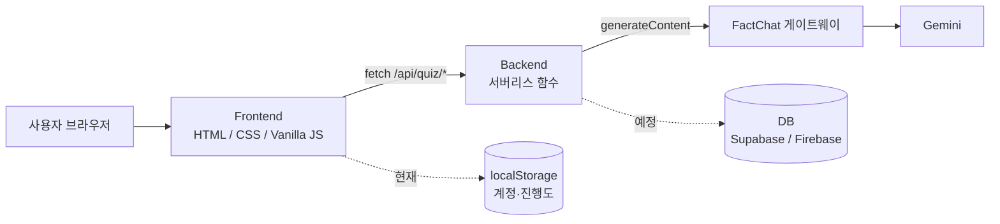
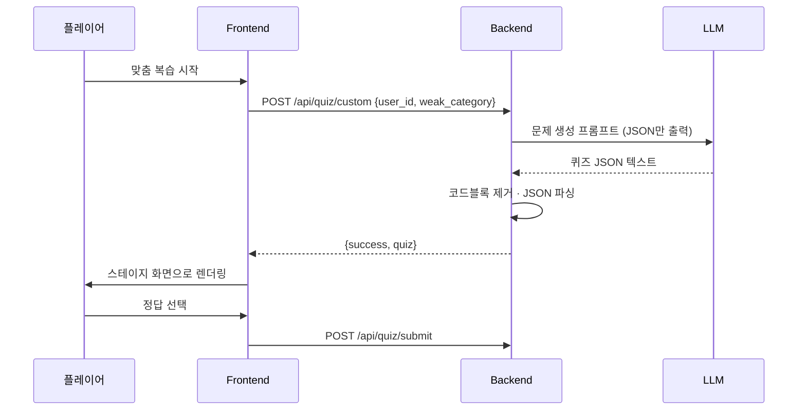

# Law-Kick Docs

프론트엔드·백엔드 두 팀이 **개발을 시작하기 전에 맞춰야 할 약속**을 모아두는 공유 문서 레포입니다.
코드보다 이 레포의 문서가 먼저 바뀌어야 합니다.

| 레포 | 역할 |
|---|---|
| `lawkick-frontend` | 화면, 게임 로직, 서버 호출 |
| `lawkick-backend` | API, LLM 문제 생성, 학습 기록 저장 |
| `lawkick-docs` (여기) | API 명세, 기획 회의록, 아키텍처 |

---

## 1. 문서 구성

```
.
├── README.md                 # 이 파일 (문서 안내 + 핵심 규칙)
├── api/
│   └── api-spec.md           # API 요청/응답 JSON 규격 (아래 3장 내용을 이 파일로 분리해 관리 권장)
├── architecture/
│   └── architecture.md       # 아키텍처 구조도, 데이터 모델
└── meetings/
    ├── TEMPLATE.md           # 회의록 양식 (아래 5장)
    └── YYYY-MM-DD-주제.md     # 회의록
```

## 2. 문서 운영 규칙

1. **명세 먼저, 코드는 나중에.** API가 바뀌면 이 레포에 PR을 올리고 프론트·백엔드 각 1명 이상 승인 후 병합합니다.
2. 병합된 명세를 기준으로 양쪽이 구현합니다. 구현 중 명세와 다르게 해야 한다면 코드가 아니라 명세를 먼저 고칩니다.
3. 호환이 깨지는 변경(필드 삭제·이름 변경·타입 변경)은 PR 제목에 `[BREAKING]`을 붙이고 버전을 올립니다.
4. 회의가 끝나면 24시간 안에 회의록을 올립니다. 결정 사항에는 담당자와 기한을 적습니다.
5. 상태 표기: ✅ 구현됨 · 🚧 구현 중 · 📝 제안(합의 필요)

---

## 3. API 명세 (v1)

### 3.1 공통 규칙

- Base URL: 프론트와 같은 도메인의 `/api` (로컬 개발은 `vercel dev` → `http://localhost:3000/api`)
- 형식: `Content-Type: application/json`, 문자열은 UTF-8
- 성공 응답은 항상 `"success": true`, 실패 응답은 아래 형식을 따릅니다.

```json
{ "success": false, "error": "사람이 읽을 수 있는 에러 메시지" }
```

| HTTP 상태 | 의미 |
|---|---|
| 200 | 성공 |
| 400 | 필수 값 누락 / 형식 오류 |
| 405 | 허용되지 않는 메서드 |
| 500 | 서버 내부 오류 (LLM 실패 포함) |

- `user_id`: 현재 프로토타입은 이메일 또는 `"guest"`. 서버 인증 도입 시 내부 사용자 ID(UUID)로 교체 예정 📝

### 3.2 `POST /api/quiz/submit` ✅ — 학습 결과 저장

요청

| 필드 | 타입 | 필수 | 설명 |
|---|---|---|---|
| `user_id` | string | ✅ | 사용자 식별자 |
| `stage_id` | string | ✅ | 스테이지 ID (예: `j1-1`, 맞춤 문제는 `custom-…`) |
| `category` | string | | 코스/카테고리 (예: `전세 계약`) |
| `is_correct` | boolean | | 정답 여부 |
| `tries_count` | number | | 정답까지 시도한 횟수 |

```json
{
  "user_id": "user@example.com",
  "stage_id": "j1-1",
  "category": "전세 계약",
  "is_correct": true,
  "tries_count": 2
}
```

응답 `200`

```json
{
  "success": true,
  "message": "정오답 데이터가 안전하게 저장되었습니다.",
  "data": {
    "user_id": "user@example.com",
    "stage_id": "j1-1",
    "is_correct": true,
    "recorded_at": "2026-11-02T00:00:00.000Z"
  }
}
```

에러: `400` (`user_id`/`stage_id` 누락), `405`, `500`

### 3.3 `GET|POST /api/quiz/custom` ✅ — 맞춤형 복습 문제 생성

요청 (POST는 body, GET은 query string)

| 필드 | 타입 | 필수 | 설명 |
|---|---|---|---|
| `user_id` | string | | 사용자 식별자 |
| `weak_category` | string | | 취약 카테고리. 기본값 `전세 계약` |

```json
{ "user_id": "user@example.com", "weak_category": "전세 계약" }
```

응답 `200`

```json
{
  "success": true,
  "quiz": {
    "id": "custom-1762041600000",
    "title": "전세 계약 맞춤형 복습 퀴즈",
    "q": "문제 지문",
    "opts": [
      ["정답 보기 텍스트", 1, ""],
      ["오답 보기 텍스트 1", 0, "오답 해설"],
      ["오답 보기 텍스트 2", 0, "오답 해설"],
      ["오답 보기 텍스트 3", 0, "오답 해설"]
    ],
    "explain": "상세한 정답 및 개념 해설",
    "laws": [["관련 법령 이름", "법령 조항 내용"]]
  }
}
```

`quiz` 필드 규격

| 필드 | 타입 | 설명 |
|---|---|---|
| `id` | string | `custom-<timestamp>` |
| `title` | string | 문제 제목 |
| `q` | string | 문제 지문 |
| `opts` | `[string, 0\|1, string][]` | `[보기, 정답여부(1=정답), 오답 해설]`. 보기 4개, 정답 1개 |
| `explain` | string | 정답 해설 |
| `laws` | `[string, string][]` | `[법령명, 조항 내용]` |

에러: `405`, `500` (LLM 실패 / JSON 파싱 실패)

### 3.4 제안 중인 API 📝 (합의 필요)

현재 프론트엔드는 아래 기능을 서버가 아닌 **플랫폼 주입 객체 또는 localStorage**에 의존합니다. 서버로 옮길 때 사용할 후보 규격입니다. 회의에서 확정 후 3.2~3.3과 같은 형식으로 승격합니다.

| 기능 | 후보 엔드포인트 | 현재 프론트 상태 |
|---|---|---|
| 회원가입 / 로그인 | `POST /api/auth/signup`, `POST /api/auth/login` | localStorage 계정 |
| AI 진행자 질문 답변 | `POST /api/quiz/ask` | `aiAsk()` · 실패 시 로컬 키워드 매칭 |
| AI 분석 피드백 | `POST /api/quiz/feedback` | `aiFeedback()` · 실패 시 로컬 피드백 |
| 랭킹 조회 / 갱신 | `GET /api/ranking`, `PUT /api/ranking/me` | `renderRank()`, `syncRank()` |
| 진행도 저장·복원 | `GET/PUT /api/progress` | localStorage `lk_prog_<email>` |
| 취약 카테고리 산출 | `GET /api/quiz/weak-category` | 프론트에서 `전세 계약`으로 고정 |

후보: AI 질문 `POST /api/quiz/ask`

```json
// 요청
{
  "user_id": "user@example.com",
  "stage_id": "j1-1",
  "question": "등기부등본에는 뭐가 적혀 있어요?",
  "found_clues": ["a"],
  "history": [{ "who": "me", "text": "..." }, { "who": "bot", "text": "..." }]
}
// 응답
{ "success": true, "answer": "진행자 답변", "clues": ["b"] }
```

---

## 4. 아키텍처

### 4.1 구조도



### 4.2 맞춤형 문제 생성 흐름



### 4.3 데이터 모델

프론트의 스테이지 데이터와 서버가 내려주는 `quiz`는 같은 구조를 공유합니다. 서버는 `comic`, `clues`를 생략할 수 있고, 프론트가 기본값을 채웁니다.

| 모델 | 주요 필드 |
|---|---|
| Stage | `id`, `title`, `q`, `comic[]`, `opts[]`, `explain`, `laws[]`, `clues[]` |
| Clue | `id`, `label`, `hint`, `kw[]`, `fact`, `reveal` |
| QuizLog (DB 예정) | `user_id`, `stage_id`, `category`, `is_correct`, `tries_count`, `recorded_at` |
| UserState (DB 예정) | `user_id`, `xp`, `coins`, `cleared`, `badges`, `weak_categories` |

### 4.4 주요 결정 사항 (ADR)

| 날짜 | 결정 | 이유 |
|---|---|---|
| (기입) | 프론트는 프레임워크 없이 Vanilla JS | 프로토타입 속도, 단일 파일 배포 가능 |
| (기입) | 백엔드는 서버리스 함수 | 별도 서버 운영 없이 프론트와 같은 도메인에 배포 |
| (기입) | LLM은 게이트웨이 경유, 키는 서버 환경변수로만 보관 | 클라이언트에 키 노출 방지 |

---

## 5. 회의록 양식 (`meetings/TEMPLATE.md`)

```markdown
# YYYY-MM-DD 회의 제목

- 일시: YYYY-MM-DD HH:MM
- 참석: (이름)
- 작성자: (이름)

## 안건
1.
2.

## 논의 내용
-

## 결정 사항
| 내용 | 담당 | 기한 |
|---|---|---|
| | | |

## 액션 아이템
- [ ] (담당) 할 일 — 기한

## API 명세 변경 여부
- [ ] 변경 없음
- [ ] 변경 있음 → PR 링크:

## 다음 회의
- 일시 / 안건
```

---

## 6. 현재 열려 있는 이슈 (회의 안건 후보)

1. **API 키 노출**: 백엔드 `custom.js`에 키가 하드코딩되어 있음 → 키 폐기·재발급 후 환경변수로 이전 (최우선)
2. 3.4의 제안 API 중 이번 마일스톤에 포함할 범위 결정
3. 인증 방식 결정 (자체 JWT / Supabase Auth / Firebase Auth) 및 `user_id` 형식 확정
4. DB 선택(Supabase vs Firebase)과 `QuizLog` / `UserState` 스키마 확정
5. 취약 카테고리 산출 기준 (최근 N회 오답률? 카테고리별 누적?)
6. LLM 응답 스키마 검증 실패 시 정책 (재시도 횟수, 기본 문제로 대체 여부)
7. 법령 정보의 정확성 검수 절차 (교육용 서비스이므로 2026년 기준 확인 담당자 지정)
